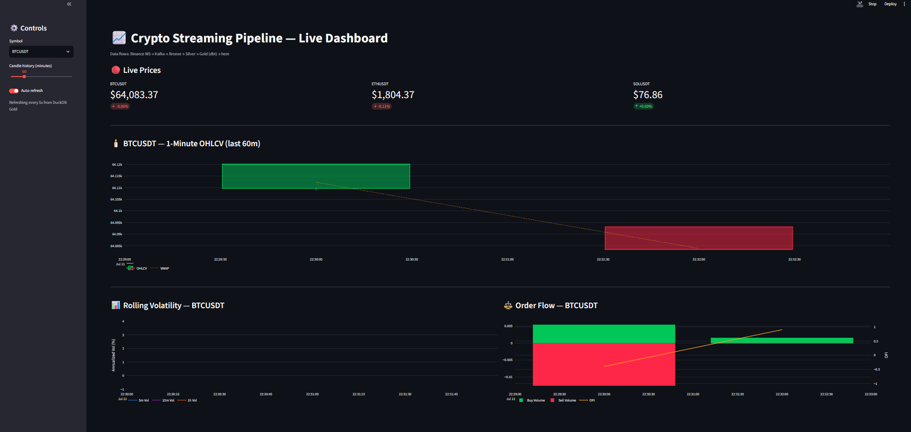

# 🌊 Crypto Streaming Pipeline

> A real-time data engineering pipeline: **Binance WebSocket → Kafka → Medallion Architecture (Bronze/Silver/Gold) → Live Streamlit Dashboard** — running entirely on your local machine, zero cloud costs.



---

## What This Project Demonstrates

This is the streaming chapter of a data engineering portfolio. It picks up where batch ELT ends and covers the concepts that matter most in real-time data systems:

| Concept | How It's Shown Here |
|---|---|
| **Kafka** | Redpanda (Kafka-compatible) via Docker Compose; topics, partitions, consumer groups, offset management |
| **WebSocket ingestion** | Binance public aggTrade stream → Pydantic validation → Kafka producer |
| **Medallion architecture** | Bronze (raw append) → Silver (OHLCV candles) → Gold (dbt analytics) |
| **Event time vs processing time** | Trades bucketed to their *occurrence* minute, not ingest time |
| **Late-arrival handling** | 90-second late window re-folds straggling events into correct candles |
| **dbt incremental models** | `{{ is_incremental() }}` / `delete+insert` — only reprocesses changed data |
| **Dagster sensors** | `bronze_parquet_sensor` triggers Silver→Gold when new Bronze files land |
| **Pydantic data contracts** | TradeEvent validated at ingest; malformed events never reach Kafka |
| **Streamlit dashboard** | Auto-refreshes from DuckDB Gold every 5 seconds |
| **DuckDB concurrent access** | Consumer writes Bronze while dashboard reads Gold simultaneously |

---

## Tech Stack

| Layer | Tool |
|---|---|
| Message broker | Redpanda (Kafka-compatible) via Docker Compose |
| Ingestion | Python + `websockets` + `confluent-kafka` |
| Data contracts | Pydantic v2 |
| Storage | DuckDB (local) + Parquet snapshots |
| Transformation | dbt-core + dbt-duckdb (incremental models) |
| Orchestration | Dagster (sensors + schedules) |
| Dashboard | Streamlit + Plotly |
| Package manager | uv |

---

## Architecture

```
Binance.US WebSocket (wss://stream.binance.us:9443)
  │  BTC-USDT, ETH-USDT, SOL-USDT live trades
  ▼
ingest/binance_producer.py  →  Kafka topic: raw-trades
  ▼
consume/bronze_consumer.py  →  DuckDB: bronze.raw_trades + data/bronze/*.parquet
  ▼  (Dagster sensor detects new Parquet files)
consume/silver_processor.py →  DuckDB: silver.ohlcv_1m, silver.trades_clean
  ▼  (dbt incremental run)
transform/models/gold/      →  DuckDB: gold.gold_vwap, gold_rolling_volatility,
                                       gold_trade_flow, gold_symbol_summary
  ▼
dashboard/app.py            →  Streamlit live dashboard (auto-refresh 5s)
```

---

## Setup

**Prerequisites:** Docker Desktop, Python 3.11+, [uv](https://docs.astral.sh/uv/)

```bash
# 1. Clone and enter the project
cd repositories/data-engineer-crypto-streaming

# 2. Install dependencies
uv sync --extra dev

# 3. Copy environment config
copy .env.example .env   # defaults work out of the box

# 4. Start Kafka (Redpanda)
docker compose up -d

# 5. Install dbt packages
cd transform && dbt deps && cd ..
```

---

## Running the Pipeline

Open four terminals:

**Terminal 1 — Kafka producer (Binance → Kafka)**
```bash
uv run python -m ingest.binance_producer
```

**Terminal 2 — Bronze consumer (Kafka → DuckDB)**
```bash
uv run python -m consume.bronze_consumer
```

**Terminal 3 — Silver processor (micro-batch, runs every 30s)**
```bash
uv run python -m consume.silver_processor
```

**Terminal 4 — Dashboard**
```bash
uv run streamlit run dashboard/app.py
# Opens http://localhost:8501
```

**Optional: Dagster UI (orchestrates Silver + Gold automatically)**
```bash
uv run dagster dev -m orchestrate -p 3001
# Opens http://localhost:3001
# Enable the bronze_parquet_sensor to auto-trigger runs
```

**Optional: dbt manually**
```bash
cd transform
dbt run --profiles-dir .     # Run Gold models
dbt test --profiles-dir .    # Run data quality tests
dbt docs serve --profiles-dir .  # Browse lineage graph
```

---

## Data Model

### Bronze — Raw Landing Zone
| Column | Type | Description |
|---|---|---|
| trade_id | BIGINT PK | Binance aggregate trade ID (dedup key) |
| symbol | VARCHAR | e.g. BTCUSDT |
| price | DOUBLE | Trade price |
| quantity | DOUBLE | Trade quantity |
| trade_time | TIMESTAMPTZ | When the trade occurred on Binance |
| received_at | TIMESTAMPTZ | When our consumer received it |
| is_buyer_maker | BOOLEAN | True = sell-initiated |

### Silver — Cleaned & Aggregated
**`silver.ohlcv_1m`** — 1-minute OHLCV candles with VWAP and buy/sell split  
**`silver.trades_clean`** — Deduplicated trades with `side` and `notional_value`

### Gold — Analytics
**`gold.gold_vwap`** — VWAP + candle change per symbol per minute  
**`gold.gold_rolling_volatility`** — Annualized vol over 5m / 15m / 1h windows  
**`gold.gold_trade_flow`** — Order Flow Imbalance + buy/sell pressure  
**`gold.gold_symbol_summary`** — Latest price, session stats per symbol

---

## Tests

```bash
uv run pytest tests/ -v
```

| Test file | What it covers |
|---|---|
| `test_producer.py` | Pydantic TradeEvent parsing, validation, serialization |
| `test_consumer.py` | OHLCV aggregation math, VWAP, buy/sell split, idempotency |

---

## Key Concepts Explained

### Medallion Architecture
Three clearly separated layers with increasing data quality and complexity:
- **Bronze**: Append-only raw data. Never modified. Source of truth.
- **Silver**: Cleaned, aggregated, and deduplicated. Business-meaningful grain (1-min candles).
- **Gold**: Analytical models. Joins, window functions, derived metrics. What the dashboard reads.

### Event Time vs Processing Time
Trades are bucketed by `trade_time` (when Binance executed the trade), *not* `received_at`. A trade executed at 10:00:59 but received at 10:01:05 belongs in the 10:00 candle, not 10:01.

### Late Arrivals
The Silver processor re-processes the last 90 seconds of Bronze data on every run. A trade that arrives up to 90 seconds late is folded into the correct candle via `INSERT OR REPLACE`.

### dbt Incremental Models
Gold models use `{{ is_incremental() }}` to skip rows that dbt already processed. On full-refresh the filter is removed; on incremental runs only recently-updated Silver rows flow through. This is the primary pattern for streaming-adjacent dbt workloads.

### Dagster Sensors
Unlike schedules ("run every N minutes"), sensors react to events. The `bronze_parquet_sensor` checks `data/bronze/` for new Parquet files and triggers a Silver→Gold run only when new data has actually landed. The cursor persists across Dagster restarts.
